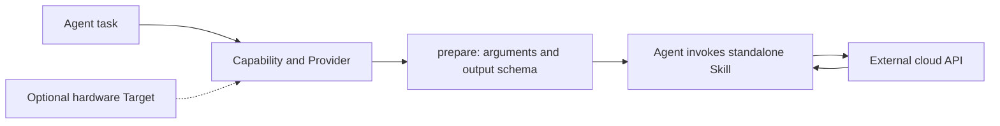

# Capability and cloud Skill architecture review

Historical review retained from 2026-11-18 (Asia/Shanghai). Package versions, paths and results below describe that reviewed snapshot. For current behavior read [architecture](../architecture/overview.md); ongoing changes and acceptance are tracked in the [optimization ledger](../development/optimization-plan.md). Package 1.0.1 subsequently removed engineering-document translations without changing runtime code.

Reviewed against [the retained plan](../development/codecraft-hardware-distilled.md), including the user corrections: Capability serves cloud Skills, the four client packages belong in this repository, and MakeCode Arcade/GameGo is excluded. Six concrete gaps were found and fixed with regressions. This review does not certify live cloud services or physical device integration.

## Responsibilities and call chain

| Owner | Responsibility | Implementation |
| --- | --- | --- |
| Device / Target | Physical facts, native peripheral interfaces and native build stacks | devices/ and platforms/ remain independent of cloud discovery |
| Capability | Versioned inputs/outputs, configuration, resources, errors and limitations | [Schema](../../capabilities/schema.py), four contracts and their tests |
| Provider | Concrete Skill binding, prerequisites, CLI mapping, API identity, package hashes and dependencies | [Catalog](../../capabilities/catalog.py) and Provider manifests |
| Cloud Skill | File checks, authentication, HTTP/SSE, local output and explicit archival | [Standalone packages](../../skills/README.md); server runtime remains external |
| Shared workflow | Context, selection, preparation, export, locks and evidence | [Project flow](../../skills/_shared/project.py); no implicit cloud execution |

Preparation returns execution=not_run. The Agent invokes the selected Skill within the authorized task and handles its exit status and output contract. An explicit Target is checked as optional context, never as evidence of firmware support. Standalone installation needs neither another Skill nor the original cloud checkout. Authentication and network execution remain owned by the Skill.

## Findings fixed

| Priority | Before: trigger and impact | Fix and regression |
| --- | --- | --- |
| P2 | Cloud-only ASR preparation required a Target and loaded the entire hardware catalog | Independent cloud catalog; optional validated --target. All four cloud commands pass with no devices/ or platforms/ directories; an invalid explicit Target fails |
| P2 | Successful TTS/image archival returned authentication, rejected by strict output schemas | Both contracts and matching Provider contract versions are 1.0.1. Actual prepared clients validate local/archived output, stream completion, failures and retained files. Skill versions remain 1.0.0 because package bytes did not change |
| P2 | Installed-package checks ignored extra modules and could execute unpinned cached bytecode during --help | Compare complete inventory, reject missing/extra/symlink files, execute a fresh pinned-source copy without Python environment/user-site/bytecode writes. A valid-looking replacement bytecode fixture cannot affect the check |
| P2 | Empty objects, false and empty strings were normalized to no Capability; an explicit JSON null file was treated as omitted | Enforce selection lists in generation, CLI and profiles; reject malformed environment/limits. Fail before project creation and when re-locking invalid profiles |
| P2 | Native directory filtering could omit a pinned Skill binary asset | Separate complete package inventory and explicit graph roots for every pinned file. A synthetic vocabulary.bin survives context/export/lock/package; mutation invalidates its lock |
| P2 | String fixed_arguments split into characters; duplicate mappings could alter CLI meaning | Require object mappings, lists of valid fixed flags and uniqueness per operation; negative regressions reject malformed and ambiguous mappings |

The previous --help and direct-client tests did not connect Provider mappings to actual outputs. Eight new Capability-owned tests now exercise metadata → prepare → isolated CLI → loopback API → actual output schema/exit status. Python caches and .DS_Store are deliberately excluded from package identity and are not copied for CLI validation. Private package files and symlinks are rejected. The binary fixture is not a claim that a real local model artifact is registered.

## Plan checks and validation

The four domains, generated indexes, native adapters, external project generation, dependency closure and locks remain implemented. GPIO/display/audio stay in Device/Target metadata. Selected cloud packages enter exports and locks; unselected packages do not. The upstream checkout remains untouched and import provenance is retained. No cloud server or account subsystem was introduced. Maintenance and maturity remain explicit rather than derived from test success.

Static/host validation passed **86 checks**, including **67 host tests**: 14 regressions added here, including eight Capability-to-client tests. The original nine offline protocol tests also pass via the existing wrapper. Full native/clean-project results, actual toolchains and durable records are in the [validation report](refactor-validation.md). Sources: [architecture tests](../../skills/_shared/tests/test_architecture.py), [installation tests](../../skills/_cloud/tests/test_installation.py), [loopback harness](../../capabilities/_tests/skill_harness.py), and each Capability's tests/test_contract.py.

Method: direct plan/source comparison, structural CodeGraph queries and runnable counterexamples. The optional OCR reviewer could not start because its configured gpt-5.5 model returned model_not_found/unknown provider; no independent OCR result is claimed. Existing user changes were preserved. All 28 imported cloud package files and native source/configuration inputs remain unchanged from the start of this review.

Live API execution, billing/quota behavior and physical device/cloud integration remain not_run. Unmeasured resources and device compatibility remain unknown. Simulation and licensed device imagery remain unsupported/unverified where no implementation or evidence exists. Offline success does not resolve the upstream historical image-generation HTTP 502 observation.
